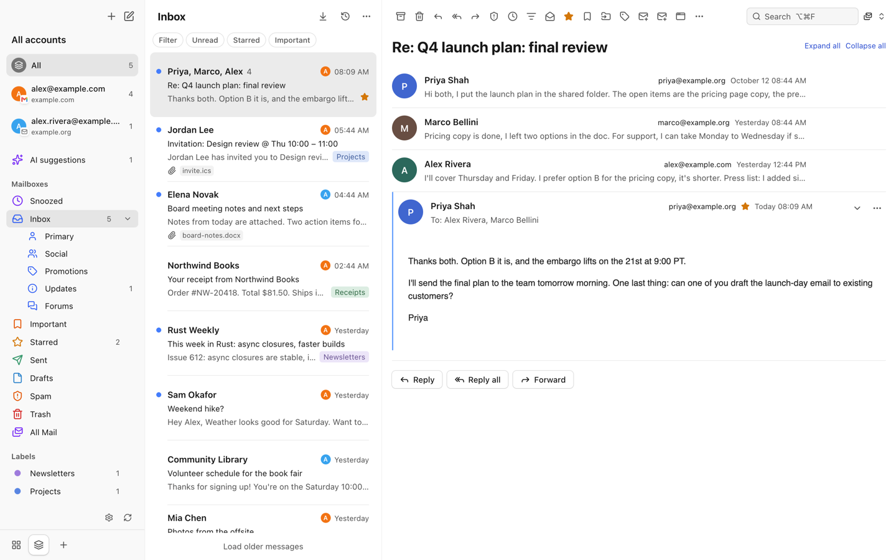
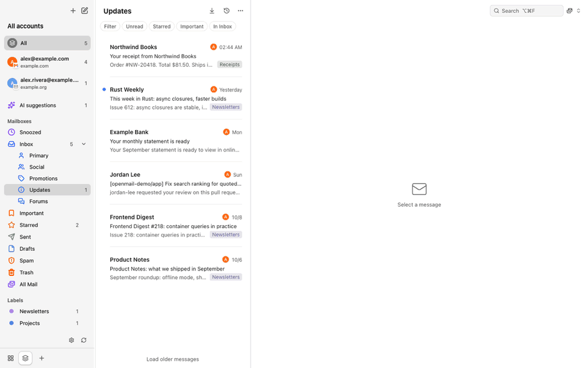
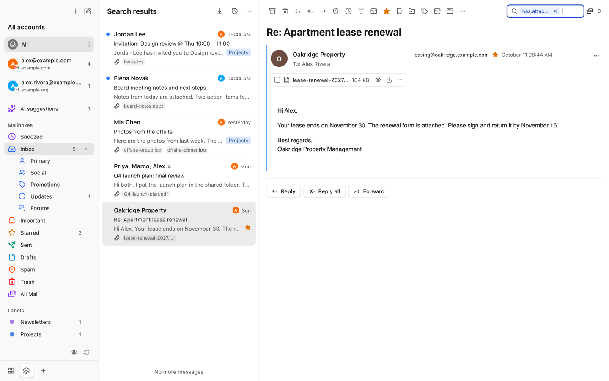
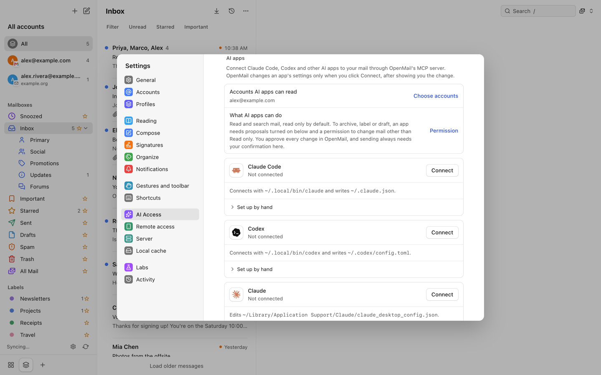
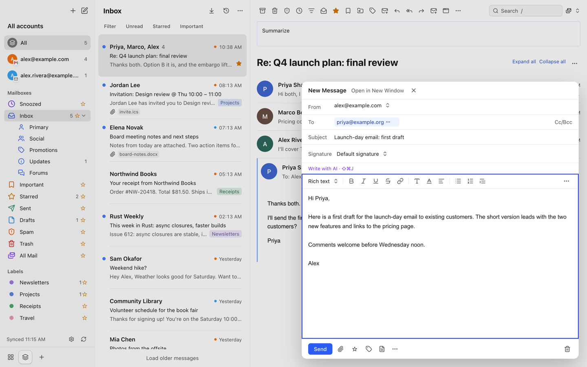
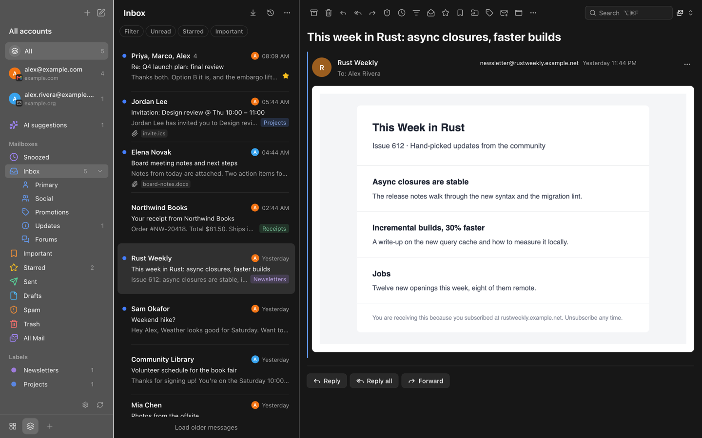

# OpenMail

[](https://github.com/Fanzzzd/openmail/actions/workflows/check.yml)
[](LICENSE)
[](#安装)

[English](README.md) | 简体中文

**邮件存在你的 Mac 上，只有你允许的 AI 代理能读。**



OpenMail 把你的邮件存在 Mac 上的一个 SQLite 数据库里。app、CLI 和 MCP 服务器共用这一个数据库。Claude Code、Codex 等 AI 代理可以读取你允许的账户。代理想改动邮件时，OpenMail 把改动变成一条 AI 建议，你在 app 里批准之前什么都不会发生。

OpenMail 是一个以键盘操作为主的 macOS 邮件客户端，同步 Gmail、个人 Outlook 和 IMAP 账户。app 直接连接你的邮件服务商。没有 OpenMail 服务器，也没有遥测。

OpenMail 处于早期测试阶段，还有不少粗糙的地方。遇到问题请提交到 [Issues](https://github.com/Fanzzzd/openmail/issues)。

## AI 代理，由你批准



录屏里，Claude Code 通过 MCP 请求归档三封订阅邮件。OpenMail 把请求连同代理给出的理由列在 **AI suggestions** 里。点 **Approve** 之后，这三封邮件才离开收件箱。

- **按账户授权。** 你在 **Settings → AI Access** 里为某个账户打开 **Allow AI to read this account** 之后，代理才能看到它。每次工具调用都会检查这项授权。
- **默认只读。** MCP 工具可以读取和搜索邮件。**Changes by AI apps** 默认是 **Read only**，此时所有写工具都会拒绝执行。
- **AI 建议。** 写工具需要两个开关：连接 app 时勾选 **Allow AI suggestions**，并把 **Changes by AI apps** 设为 **Ask me first**。之后 `modify_threads`、`snooze_threads` 和 `draft_message` 只会创建 AI 建议。每条 AI 建议留在 **AI suggestions** 里，等你批准或拒绝。
- **代理不能发信。** 代理起草的邮件会在撰写窗口打开，由你自己发送。
- **在设置里连接。** OpenMail 可以替你连接 Claude Code、Codex、Claude 和 Cursor。它先显示配置 diff，只改 `openmail` 条目。其他 MCP 客户端可以运行 `/Applications/OpenMail.app/Contents/MacOS/OpenMail --mcp`。
- **内置 AI，默认关闭。** 使用你自己的 Anthropic API key，只作用于你允许的账户：摘要、邮件助手、写作帮助和收件箱分拣。助手同样只给出 AI 建议，不直接改动邮件。

工具列表和批准规则见 [CLI 与 MCP](https://openmail-docs.vercel.app/docs/cli-and-mcp)。

## 功能

- **账户。** Gmail、个人 Outlook（outlook.com、hotmail.com、live.com）、iCloud、Yahoo、QQ、163、Fastmail，以及任意 IMAP/SMTP 服务器。不支持工作或学校的 Microsoft 365 账户。
- **本地优先。** 阅读、搜索和整理都可以离线进行。改动先排队，联网后再同步到服务器。
- **本地搜索。** 全文检索（SQLite FTS5）支持布尔、短语、日期、大小和附件运算符，可以合并服务器结果。可选本机 OCR、PDF 文本和语义搜索。
- **键盘优先。** 三套快捷键（Mimestream、Gmail、Apple Mail），消息内链接提示，前进和后退，列表、阅读区、撰写窗口和设置都能用键盘操作。
- **通过 Tailscale 在手机上访问。** 通过你自己的 tailnet 在手机浏览器里打开邮箱。默认关闭，不暴露到公网，只允许你指定的 Tailscale 登录账号。
- **十种语言。** 英语、简体中文、捷克语、荷兰语、法语、德语、意大利语、日语、俄语和西班牙语。
- **安全阅读。** 邮件 HTML 在禁止脚本的沙箱里渲染。任何远程图片设置下都会移除已知跟踪器。

<table>
  <tr>
    <td></td>
    <td></td>
  </tr>
  <tr>
    <td></td>
    <td></td>
  </tr>
</table>

截图和录屏使用 [`scripts/demo-data.mjs`](scripts/demo-data.mjs) 生成的假邮件，待批准的 AI 建议也由它生成。

## 对比

|                    | OpenMail                | Mimestream        | Spark                        | Thunderbird                    | Apple Mail         |
| ------------------ | ----------------------- | ----------------- | ---------------------------- | ------------------------------ | ------------------ |
| 源码               | 开源（MIT）             | 闭源              | 闭源                         | 开源（MPL 2.0）                | 闭源               |
| 价格               | 免费                    | 付费订阅          | 免费，有付费方案             | 免费                           | macOS 自带         |
| 平台               | macOS（手机端开发中）   | macOS             | macOS、iOS、Android、Windows | Windows、macOS、Linux、Android | macOS、iOS、iPadOS |
| Gmail              | 支持（Gmail API）       | 支持（Gmail API） | 支持                         | 支持（IMAP）                   | 支持（IMAP）       |
| 个人 Outlook       | 支持（Microsoft Graph） | 不支持            | 支持                         | 支持                           | 支持               |
| 其他 IMAP          | 支持                    | 不支持            | 支持                         | 支持                           | 支持               |
| 邮件经过厂商服务器 | 否                      | 否                | 部分功能会                   | 否                             | 否                 |
| 成熟度             | 早期测试                | 成熟              | 成熟                         | 成熟                           | 成熟               |

OpenMail 比以上产品都年轻，还有粗糙的地方。Gmail 功能以 Mimestream 为参照，差距记录在 [docs/parity.md](docs/parity.md)。表格依据各产品 2026 年 10 月的公开页面。如有错误，请提交 issue。

## 安装

目前还没有发布版本，需要从源码构建：

1. 安装[前置依赖](CONTRIBUTING.md#prerequisites)：macOS 13+、Node 24（见 `.nvmrc`）、通过 `corepack enable` 启用的 pnpm，以及 Xcode Command Line Tools。Xcode 26 可选。装了它，`dist` 会编译 Icon Composer 图标，macOS 26 上显示 Liquid Glass 图标及其深色和着色外观。没装，`dist` 打包仓库里的 `build/icon.icns`，即同一图标的静态渲染，所有 macOS 版本都原样显示。Xcode 26 需要 macOS 15.6 或更高版本。OpenMail 需要 Node 24，即 `.nvmrc` 里的版本。Node 22 每次调用 CLI 都会打印 `node:sqlite` 警告，Node 25 及以上不再自带 corepack。
2. 构建并打包：

   ```sh
   git clone https://github.com/Fanzzzd/openmail.git
   cd openmail
   pnpm install
   pnpm build
   pnpm --filter @openmail/desktop dist   # Xcode 26 可选，见第 1 步
   ```

3. 打开 `apps/desktop/release/OpenMail-<version>-mac-<arch>.dmg`，把 OpenMail 拖到“应用程序”。

发布版本上线后，可以从 [GitHub Releases](https://github.com/Fanzzzd/openmail/releases) 下载 DMG。自己构建的 app 可以直接打开。下载的未公证构建首次打开会被 Gatekeeper 拦截。先打开一次，再到 **系统设置 → 隐私与安全性** 点按 **仍要打开**。

## 快速上手

1. 打开 OpenMail，选择 **Gmail**、**Outlook** 或某个 IMAP 服务商。源码构建不带内置 OAuth 客户端：按 [Using your own OAuth client](https://openmail-docs.vercel.app/docs/own-oauth-client) 的说明为 Google 或 Microsoft 注册自己的客户端，填到添加账户页面。IMAP 只需要应用专用密码。
2. OpenMail 先下载最近的邮件，再在后台补全旧邮件。
3. 按 `?` 查看快捷键，按 `⌘F` 搜索。[快捷键参考](https://openmail-docs.vercel.app/docs/keyboard-shortcuts)列出了全部三套。
4. 要在 Claude Code 或 Codex 里使用邮件，打开 **Settings → AI Access**，允许对应账户，再在 **AI apps** 下连接该应用。也可以让任意 MCP 客户端运行 `/Applications/OpenMail.app/Contents/MacOS/OpenMail --mcp`。源码检出的 CLI 命令见 [Connect by hand](https://openmail-docs.vercel.app/docs/cli-and-mcp#connect-by-hand)。

## 隐私

- 邮件、附件和搜索索引保存在 `~/Library/Application Support/openmail`（可用 `OPENMAIL_HOME` 修改）。
- refresh token、IMAP 密码和 API key 只存进 macOS 钥匙串。
- app 连接你的邮件服务商。只有你打开 AI 时，它才会用你自己的 key 连接 Anthropic，并且只涉及你允许的账户。
- 没有遥测，没有统计分析，没有 OpenMail 服务器。

详见[隐私政策](https://openmail-docs.vercel.app/privacy)和[安全模型](https://openmail-docs.vercel.app/docs/security)。

## 文档

用户文档：**[openmail-docs.vercel.app](https://openmail-docs.vercel.app)**。开发文档在 [`docs/`](docs/)：[架构](docs/architecture.md)、[测试](docs/testing.md)、[发布](docs/release.md)、[安全](docs/security.md)和[术语表](CONTEXT.md)。同步正确性、性能等部分深入说明仍是中文。

## 参与贡献

欢迎提交 bug 报告、修复和翻译。环境搭建、每个改动必须通过的检查和架构规则见 [CONTRIBUTING.md](CONTRIBUTING.md)。开发时请用单独的数据目录启动 app，不要碰已安装 OpenMail 的真实邮件：

```sh
pnpm build
cd apps/desktop
pnpm exec electron-vite dev -- --user-data-dir="$HOME/OpenMail-dev"
```

`--user-data-dir` 会把 Electron 配置和 OpenMail 数据库都放进这个目录。没有真实账户时，可以运行 `node scripts/demo-data.mjs "$HOME/OpenMail-dev"` 填入假邮件。

问题和想法请发到 [Discussions](https://github.com/Fanzzzd/openmail/discussions)。安全问题请按 [SECURITY.md](SECURITY.md) 私下报告。

## 许可证

[MIT](LICENSE) © 2026 Fanzzzd and OpenMail contributors。第三方资源和库（包括 LGPL-3.0-or-later 授权的 libvips）列在 [THIRD_PARTY_NOTICES.md](THIRD_PARTY_NOTICES.md)。服务商图标来自 [selfh.st](https://selfh.st/icons)（CC BY 4.0）。
